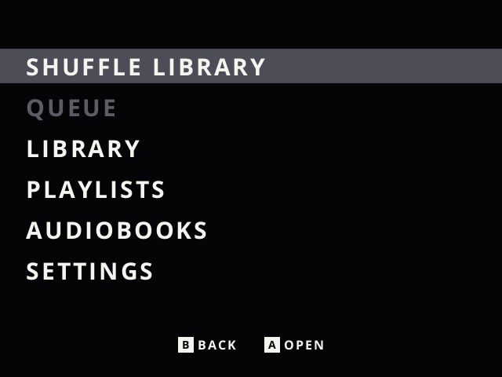
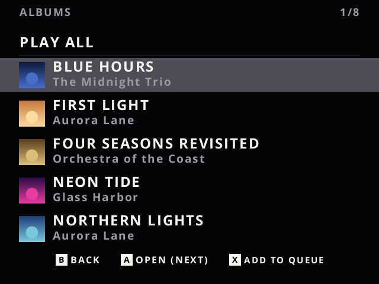
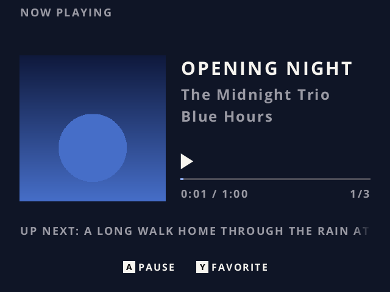
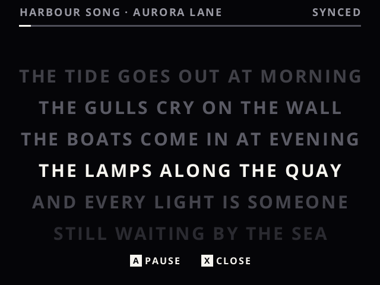
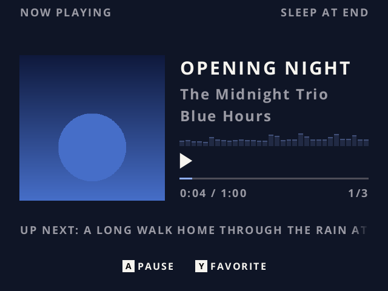
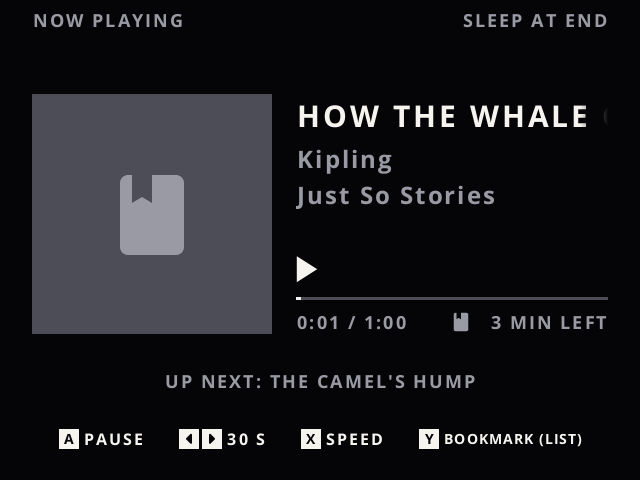

# slot, with music

[slot](https://github.com/BrandonKowalski/slot) is Brandon Kowalski's bespoke, Game Boy-centric
frontend for the Anbernic RG SP. This is [pvaibhav's fork](https://github.com/pvaibhav/slot) of it,
with a music and audiobook player built in: [mute](https://github.com/bphenriques/mute-player).
Everything else, what slot does, setting it up, supported devices and the guide at
[slot-cfw.fyi](https://slot-cfw.fyi), is as upstream documents it: see
[pvaibhav's README](https://github.com/pvaibhav/slot) and [Brandon's](https://github.com/BrandonKowalski/slot).

> [!WARNING]
> **Experimental, and built with AI assistance.** This fork adds a music and audiobook player
> to slot. I have experience in the field and did my best to follow the right patterns, but I am
> not an expert on this, and in the end I wanted a fast, clean music player running in slot.
> It may be unstable: expect rough edges, things that break or change between builds, and keep
> a backup of your card.
>
> Don't expect much support. I'm happy to help where I can, and happier still if someone forks
> it and carries on the work (I'd gladly use the mature fork!) :)

What I focused on:

- **Pocket use.** With the screen off, the shoulders skip or seek and the triggers play, pause
  or mark a place in a book, all found by feel; holding two shoulders locks the keys, or the
  screen going off can lock them, so nothing changes in a pocket. I haven't seen this in a
  handheld player before.
- **Performance.** It's a battery device: nothing runs while idle, and the screen is drawn only
  when something on it changes.
- **A decoupled design.** The player is its own crates, [mute](https://github.com/bphenriques/mute-player),
  with slot only hosting it, so it isn't tied to slot.
- **Minimal and modern.** Familiar keys, one kind of row, quiet animations, light and dark.

## Music and audiobooks

QUICK MENU › MUSIC plays what is on the card, offline.

- **Music:** by artist, album, song, genre, year or folder, with album art, `.m3u` playlists,
  Favorites, Recently Played and Recently Added. Gapless, with Crossfade between albums, Volume
  Leveling, an equalizer (its presets and your own), synced lyrics and an optional visualizer.
- **Audiobooks:** each keeps its place, speed, chapters and bookmarks, with a sleep timer that
  stops at the end of a chapter, and In Progress and Finished lists.
- **In a pocket:** with the screen off (the lid closed, or POWER), L1 and R1 skip (in a book,
  jump back or on) and held seek; L2 and R2 play or pause, and held in a book mark the moment.
  Any two of them held lock the keys or unlock them. Settings › Screen Off chooses whether music
  pauses, keeps playing, or keeps playing with the keys locked.
- **On the card:** songs in `Music/`, books in `Audiobooks/` (or wherever `Config/music.txt`
  says), and the settings in `Config/music.txt`, with an example beside it. mute's
  [card guide](https://github.com/bphenriques/mute-player/blob/main/music/README.md) has the rest.
- **Formats:** MP3, AAC and Apple Lossless, FLAC, Ogg Vorbis, Opus and WAV.

## Getting it

Download the zip from the [current release](https://github.com/bphenriques/slot/releases/tag/v1.9.0-bphenriques.1)
and put it on the card as upstream's guide says for slot. Its
[release notes](RELEASE_NOTES.md) describe the changes since the previous fork release.

A release uses upstream's version with a `-bphenriques` suffix: `v1.9.0-bphenriques.1` is the
first built on upstream 1.9.0, and `v1.9.0-bphenriques.2` would be the second.

## Credits

slot is Brandon Kowalski's, with art by [Markus](https://github.com/MarkusMaribu); mGBA and
gpSP play the games; pvaibhav's fork adds its own features on top. As upstream says, its frontend
was put together with Claude, and this fork's player was written with AI assistance too.
Licences, and every crate the player links, are in `System/licenses/` on the card.
