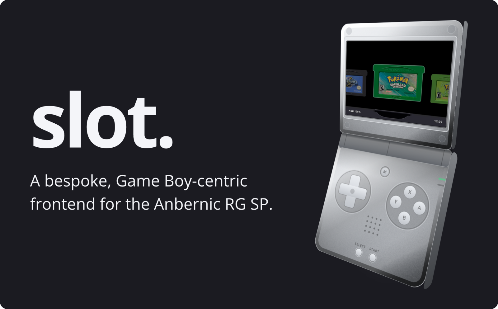

---

# What is slot?

A fork of [slot](https://github.com/BrandonKowalski/slot) by Brandon Kowalski. slot is a
bespoke, Game Boy-centric frontend for the Anbernic RG SP. Brandon wrote slot and its guide.
This fork follows upstream and adds the features listed below.

Has support for GBA, GBC, and GB titles only.

> [!IMPORTANT]
> ROMs must be unzipped. slot does not read `.zip` or `.7z` files.

The user guide is upstream's, at [slot-cfw.fyi](https://slot-cfw.fyi). Upstream's release
notes are in the [changelog](CHANGELOG.md).

## What this fork adds

- **Lower input lag with automatic 120 Hz** on supported RG SP, RG34XX SP, and RG34XX
  panels. Other panel revisions keep their existing refresh rate.
- ~~**Better battery life and less heat** with the `schedutil` CPU governor.~~
  Removed upstream in **v1.11.0** after reports of stuttering; this fork follows
  upstream and leaves the CPU governor at the kernel default.
- ~~**LCD ghosting / interframe blending.**~~ Included upstream since **v1.10.0**
  as **Frame Blending** under Settings > Screen.
- **Colour calibration** for the RG SP and RG34XXSP panels, based on an accurate 3x1D LUT
  measured by me. Both white point and gamma curve are corrected. Currently no other firmware
  has this!
- ~~Holding POWER **shuts down** directly, without showing a menu.~~
  Included upstream since **v1.8.0**. Restart is available from Settings > About with X.
- **Home Wi-Fi.** Slot can now connect to your home Wi-Fi. Just set up your Wi-Fi credentials
  in `Config/wifi.toml` and then turn HOME WI-FI on under General. Everything happens
  automatically from then onwards. Most of the features below depend on this.
- **Hassle-free cart label scraping.** Just throw your ROMs on the SD card, and slot downloads
  missing labels in the background. It will not replace a label you added yourself, though.
  No config is needed for this feature. No Wi-Fi? Put `Artwork.pack` from the release page in
  your card's `Labels` folder and slot labels your carts from that instead.
- **RetroAchievements.** You can earn softcore GB, GBC, and GBA achievements, online or offline.
  Put your account in `Config/retroachievements.toml` for this to work. All your games' achievements
  will be cached if Wi-Fi is on, so once the sync is done, you can go out and play without
  losing your achievements. They'll sync automatically when you're back home. When you're
  playing at home with Wi-Fi on, your achievements will sync in real time with rich presence.
  A holographic trophy seal on a cart's label shows it's ready to earn achievements offline.
- **Linking over home Wi-Fi.** When at home and connected to Wi-Fi, two handhelds can link
  using that instead of having to create ad hoc networks. Outside of home, you can continue
  using slot's normal method. This works seamlessly, no config needed.
- **Cheats.** Put `Cheats.pack` from the release page in `Cheats/`, and a game's cheats from the
  libretro database appear under **Cheats** in its in-game menu, each with an On/Off switch.
  slot remembers which are on for each game. To use your own, add a RetroArch `.cht` file named
  after the ROM to `Cheats/GBA`, `Cheats/GB` or `Cheats/GBC`. Cheats need the mGBA core.

Existing blending preferences are kept: the old On setting becomes Mix, and Off stays Off.
mGBA also offers upstream's LCD Ghosting mode.

## How to configure

The release includes an `.example` copy of each config file in `Config/`. Remove `.example`
from the name, and fill in your details. You only need to configure your Wi-Fi and
RetroAchievements credentials. Everything else is automatic.

## Versions

A release of this fork uses upstream's version with a suffix. `v1.4.0-pvaibhav.1` is the
first release built on upstream 1.4.0, and `v1.4.0-pvaibhav.2` would be the second.

The current release is [v1.11.0-pvaibhav.1](https://github.com/pvaibhav/slot/releases/tag/v1.11.0-pvaibhav.1).
Its [release notes](RELEASE_NOTES.md) describe the changes since the previous fork release.

## Release cadence

This fork is synced to upstream slot releases every day at **07:30 CET Berlin time /
02:30 EDT New York time**. If a new version of slot
is available, it is merged into this fork and released automatically.

I release new features as I build and test them. They are carried forward in every new release.

---

# What does it look like?

---

# Supported Devices

| Device             | Supported                                    | Since Version |
|--------------------|----------------------------------------------|---------------|
| Anbernic RG SP     | Yes                                          | Always        |
| Anbernic RG34XX    | Yes                                          | 1.4.0         |
| Anbernic RG34XXSP  | Yes                                          | 1.4.0         |
| Anbernic RG35XXSP  | Yes                                          | 1.5.0         |
| Anbernic 35XX Plus | Yes                                          | 1.5.0         |
| Anbernic RG28XX    | Yes                                          | 1.6.0         |
| Anbernic RG35XX-H  | Yes                                          | 1.7.0         |

If you have one of the untested devices, or have tried slot on a device not listed,
please [open an issue on GitHub](https://github.com/BrandonKowalski/slot/issues) and let me know how it went.

---

# AI Disclosure

From upstream:

The Rust frontend, and the SVGs on [slot-cfw.fyi](https://slot-cfw.fyi), were put together by Claude.
I reviewed everything that was produced. All documentation is 100% free-range, meatbag prose.

My goal with this project was to recreate the feeling of playing my GBA SP in the back seat as a kid,
but with a few modern creature comforts.

Nothing about this project is exciting or groundbreaking from a technological perspective, and as a
result, I delegated the glue code. mGBA and gpSP have been around forever and are the true stars of
this show. The incredible skeuomorphic art is the work of [Markus](https://github.com/MarkusMaribu), an
artist who saw the bare-bones version and offered to dress it up.

I understand if my use of AI is a dealbreaker for you. Just know it's the least interesting part of
what's here.

This fork's additions were written with AI assistance too.

Figured I should share the end result of all the wasted water. ✌🏻

---

# Spread Joy!

I've spent a lot of time building slot.

If you enjoy using it and feel inclined to pay it forward, go do something nice for someone! ❤️
